# Квартал загадок · Pixel Logic Quarter

**25 мест · 75 уровней · мышь и касания · работает офлайн**

Минималистичный пиксельный квартал с классическими задачами и игровыми экспериментами. Нажмите на здание, решите головоломку и зажгите ещё один огонь. Почтальон предлагает следующий адрес, жители возвращаются на улицы, а путь ведёт от первых огней к ночному празднику.


**[Иллюстрированное оглавление](catalog.html)** · **[Подробные правила всех задач](docs/CATALOG.md)** · **[Скачать готовый HTML](https://github.com/nglain/pixel-logic-quarter/raw/refs/heads/main/index.html)**

## Оглавление

- [Быстрый запуск](#быстрый-запуск)
- [Как играть](#как-играть)
- [25 игровых локаций](#25-игровых-локаций)
- [Своя загадка](#своя-загадка)
- [Ещё 21 идея](#ещё-21-идея)
- [Разработка и проверки](#разработка-и-проверки)
- [Документация и графика](#документация-и-графика)

## Быстрый запуск

Скачайте **[index.html](https://github.com/nglain/pixel-logic-quarter/raw/refs/heads/main/index.html)** и откройте его в современном браузере. Всё уже внутри: сервер, установка зависимостей, регистрация и интернет для игры не нужны. Просмотр HTML прямо на GitHub показывает исходник — файл нужно скачать.

Для оглавления скачайте репозиторий целиком и откройте `catalog.html`: ссылки из него ведут в нужные сцены `index.html`.

Для постоянного локального адреса из папки проекта:

```sh
python3 -m http.server 8000
```

Откройте `http://localhost:8000`. Прогресс хранится в `localStorage`. Другой браузер, другой адрес или удаление данных сайта дают отдельное сохранение. Если браузер запрещает хранилище, игра доступна, но сохранение после закрытия не гарантируется.

## Как играть

- Все 25 мест сразу на одной карте. В каждом три уровня; следующий открывается после решения текущего.
- Первый уровень показывает, куда нажать. На следующих постоянных инструкций нет; **«Подсказка»** объясняет полезное действие по запросу.
- **`?`** — правила, **`↻`** — повтор, **`←`** — карта, **`↶`** — отмена там, где она применима.
- Каждый впервые пройденный уровень зажигает один из **75 огней**. Повтор, отмена и перезагрузка не выдают повторную награду и не стирают заработанный прогресс.
- Почтальон чередует головоломки; можно выбрать любой другой адрес. `0/3`…`3/3` показывает пройденные уровни, звезда — полностью завершённое место.
- Герои двигаются по полям, механизмы реагируют на действия, жители благодарят за победу. Режим уменьшенного движения отключает перелёты и постоянную анимацию.

Кафе, сейф, весы, ограниченные осмотры и вопросы свидетелям не возвращают уже полученную информацию через отмену. В пространственных играх и редакторе отмена восстанавливает положение и счётчики; история ограничена 24 принятыми действиями на коллекцию. Подсказки бесплатны и работают локально.

## 25 игровых локаций

У каждой локации ниже есть три готовых уровня. Ссылка открывает полные правила, управление, принцип подсказки и ступени сложности.

<!-- LOCATIONS:START -->
| | Место | Задача | Три уровня |
|---|---|---|---|
| 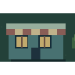 | [Кафе](docs/CATALOG.md#cafe) | Определи содержимое трёх автоматов по наклейкам и купленным пробам. | Все наклейки ложные; 3 монеты. → Ровно одна наклейка верна; 3 монеты. → Наклейкам нет гарантий; 6 монет. |
| 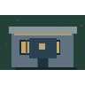 | [Сейф](docs/CATALOG.md#safe) | Подбери код по точным и неполным совпадениям. | 2 цифры 0–3, 6 попыток. → 3 цифры 0–5, 8 попыток. → 4 цифры 0–5, 10 попыток. |
| 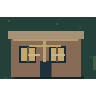 | [Весы](docs/CATALOG.md#scales) | Найди отличающуюся монету ограниченным числом сравнений. | 3 монеты, 1 взвешивание, одна тяжелее. → 9 монет, 2 взвешивания, одна тяжелее. → 9 монет, 3 взвешивания, вес отличается в неизвестную сторону. |
| 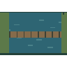 | [Переправа](docs/CATALOG.md#river) | Перевези пассажиров, сохраняя безопасность обоих берегов. | Коза и капуста: освоить посадку и возврат. → Добавляется волк; лимита рейсов нет. → Все трое; уложиться в 7 рейсов. |
| 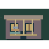 | [Башня](docs/CATALOG.md#hanoi) | Перенеси стопку дисков на правую стойку. | 2 диска; оптимум 3 хода. → 3 диска; оптимум 7 ходов. → 4 диска; оптимум 15 ходов. |
| 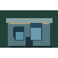 | [Кувшины](docs/CATALOG.md#jugs) | Получи точный объём с помощью двух сосудов без делений. | Кувшины 2 и 3 л; получить 1 л. → 3 и 5 л; получить 4 л. → 4 и 7 л; получить 5 л. |
| 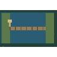 | [Мост и фонарь](docs/CATALOG.md#bridge) | Переведи всех через мост и верни фонарь нужным людям. | Скорости 1 и 2 мин; лимит 2 мин. → 1, 2 и 5 мин; лимит 8 мин. → 1, 2, 5 и 10 мин; лимит 17 мин. |
| 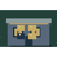 | [Свет погас](docs/CATALOG.md#lights) | Погаси поле ламп, связанных перекрёстными переключениями. | Поле 2×2. → Поле 3×3. → Поле 4×4. |
| 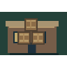 | [Склад](docs/CATALOG.md#sokoban) | Толкай ящики к меткам, не загоняя их в тупики. | Один ящик и прямая дорога к цели. → Два ящика: сначала освободить проход. → Три ящика: сначала заполнить дальнюю цель. |
|  | [Детективное бюро](docs/CATALOG.md#detective) | Найди посетителя по уликам и укажи доказательства. | Одна улика → Пересечение улик → Полное доказательство |
| 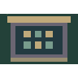 | [Лаборатория рычагов](docs/CATALOG.md#experiment) | Исследуй рычаги и получи заданное состояние механизма. | Два рычага → Связанные выходы → Зависимый механизм |
| 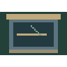 | [Предсказание](docs/CATALOG.md#prediction) | Сначала укажи выход луча, затем запусти его и проверь себя. | Одно отражение → Два отражения → Поворот у края |
| 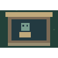 | [Ремонт программы](docs/CATALOG.md#repair) | Исправь одну команду в готовой программе робота. | Одна ошибка → Ошибка поворота → Обход стены |
| 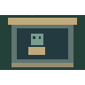 | [Мастерская роботов](docs/CATALOG.md#program) | Собери короткую программу и проверь маршрут робота. | Четыре команды → Путь длиннее → Повороты в коридоре |
| 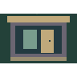 | [Часовая комната](docs/CATALOG.md#escape) | Найди подсказку, открой ящик и достань ключ от выхода. | Записка → Считаем предметы → Зеркальная запись |
|  | [Часовая мастерская](docs/CATALOG.md#clock) | Отмерь точный интервал песочными часами без делений. | Одна минута → Четыре минуты → Пять минут |
| 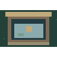 | [Ледяной пруд](docs/CATALOG.md#ice) | Скользи до препятствия и остановись на звезде. | Два скольжения → Островки льда → Путь между стенами |
| 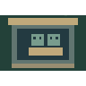 | [Зеркальный двор](docs/CATALOG.md#twins) | Управляй двумя героями одной командой. | Вместе к целям → Одна стена → Разные остановки |
|  | [Комната за окном](docs/CATALOG.md#observation) | Выбери, куда посмотреть, прежде чем назвать скрытую комнату. | Один полезный взгляд → Два признака → Что стоит проверить? |
| 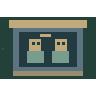 | [Два свидетеля](docs/CATALOG.md#information) | Объедини сведения людей, каждый из которых видит лишь часть предмета. | Один ответ помогает → Соединяем знания → Выбираем вопросы |
| 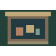 | [Лавка обменов](docs/CATALOG.md#trade) | Получи нужную вещь через цепочку обменов. | Один обмен → Собрать ключ → Смешанный платёж |
|  | [Следы событий](docs/CATALOG.md#timeline) | Восстанови порядок событий по найденным связям. | Причина и следствие → Четыре события → Точное соседство |
| 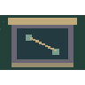 | [Бюро проектов](docs/CATALOG.md#impossible) | Найди невыполнимый проект и докажи причину. | Разорванная сеть → Без пересечений → Каждый мост один раз |
|  | [Одна лестница](docs/CATALOG.md#tool) | Переноси одну лестницу и используй её повторно. | Один разрыв → Сначала подойти → Использовать снова |
| 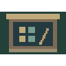 | [Мастерская загадок](docs/CATALOG.md#creator) | Создай задачу с лампами, проверь её и передай код другому игроку. | Свои четыре лампы → Свои девять ламп → Свои шестнадцать ламп |
<!-- LOCATIONS:END -->

## Своя загадка

В «Мастерской загадок» нарисуйте узор ламп, проверьте решаемость и нажмите «Играть». В редакторе клетки меняются независимо; в игре нажатие переключает саму лампу и ортогональных соседей. Нужно погасить всё поле.

Кнопка **«Код задачи»** выдаёт текст для ручного копирования. Другой игрок может загрузить его на уровне с тем же размером поля: 2×2, 3×3 или 4×4. Пустые, нерешаемые и некорректные задачи отвергаются; неудачная загрузка сохраняет текущее поле. Внешнего сервиса и автоматической публикации задач нет.

## Ещё 21 идея

В [оглавлении](catalog.html) **46 описаний в шести разделах**: 25 реализованных игр и 21 предложение. Статус указан явно; у предложений нет кнопки запуска. Для каждого описаны цель, правила, управление, три ступени и возможная подсказка.

Разделы: [найти скрытое](docs/CATALOG.md#deduction) · [спланировать ходы](docs/CATALOG.md#planning) · [построить связи](docs/CATALOG.md#connections) · [заполнить по условиям](docs/CATALOG.md#constraints) · [изменить систему](docs/CATALOG.md#systems) · [посмотреть иначе](docs/CATALOG.md#perspective).

## Разработка и проверки

Обычные HTML, CSS и JavaScript; Python собирает автономные файлы из `src/`. Готовые HTML включены в репозиторий.

```sh
npm ci
npm run build
npx playwright install chromium
npm test
```

Можно использовать установленный совместимый Chrome:

```sh
PLAYWRIGHT_EXECUTABLE_PATH=/path/to/chrome npm test
```

Проверки проходят все 75 уровней через интерфейс, обучение и открытие уровней, ошибки и повтор, подсказки, отмену, старые сохранения и reload, настоящий импорт/экспорт своей задачи, offline, touch и экраны до 320 px. Отдельно проверяются награды, движение, отсутствие повторных огней и reduced motion. Отчёты и снимки создаются в игнорируемом `test-results/`. GitHub Actions не используются.

Проверено в Chrome с эмуляцией touch. Физические телефоны, Safari/Firefox и человеческая оценка сложности отдельно не проверены. [Сведения о проверках](docs/VALIDATION.md).

## Документация и графика

| Материал | Содержание |
|---|---|
| [Оглавление](docs/CATALOG.md) | Все 46 задач, статусы, полные правила и уровни |
| [Архитектура](docs/ARCHITECTURE.md) | Владельцы состояния, симуляции, сохранений и сборки |
| [16 новых форматов](docs/ADVENTURES.md) | Механики и проверка 48 заданий, редактор и код задачи |
| [Живое прохождение](docs/LIVING-QUARTER.md) | Почтальон, огни, движение и награды |
| [Склад и отмена](docs/WAREHOUSE-ACCEPTANCE.md) | Толчки, тупики, восстановление и достижения |

В игре пиксельная графика рисуется локально через Canvas и CSS. Иконки локаций в этом README воспроизводят ту же карту. В оглавлении сохранён [исходный атлас ImageGen и промпт](assets/catalog/), а новые сцены используют [отдельный программный атлас](assets/adventures/). [Происхождение и пересборка иконок README](assets/locations/README.md).

Пользовательские сохранения, credentials и локальные отчёты в репозиторий не входят. Публикация исходников в Git не означает размещение игрового сайта.

## Лицензия

[MIT](LICENSE).
