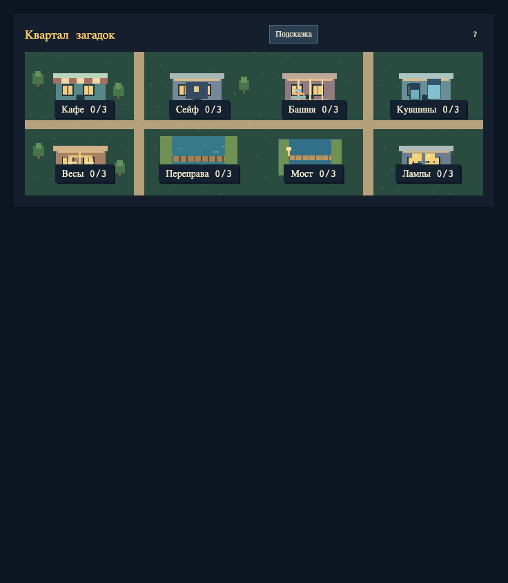

# Квартал загадок · Pixel Logic Quarter

Минималистичный пиксельный сборник классических головоломок: **8 мест на одной карте, 24 уровня, управление мышкой и подсказки по текущему положению**.

Нажмите на здание, решите задачу и откройте следующий уровень. В каждой сцене — только сама головоломка и маленький блок управления рядом.



## Как запустить

Скачайте репозиторий и откройте **[index.html](index.html)** в современном браузере. Это готовая игра: установка зависимостей, сервер и интернет для игры не нужны.

Для работы через постоянный локальный адрес:

```sh
python3 -m http.server 8000
```

Откройте `http://localhost:8000`. Прогресс хранится в `localStorage` браузера. Удаление данных сайта, другой браузер или другой адрес могут означать отдельное сохранение. Если браузер запрещает локальное хранилище, можно играть, но прогресс после закрытия не гарантируется.

## Как играть

- На карте сразу доступны все восемь мест; на узком экране они перестраиваются в две колонки.
- В каждом месте три уровня: следующий открывается после решения текущего.
- Первый уровень обучает действиям: подсветка показывает, куда нажать.
- На следующих уровнях постоянных инструкций нет. **«Подсказка»** по запросу объясняет и подсвечивает полезный ход; повторное нажатие скрывает помощь.
- **`?`** открывает правила текущей задачи, **`↻`** начинает текущий уровень заново, **`←`** возвращает на карту.
- На карте виден прогресс `0/3`…`3/3`. Звезда означает, что завершена вся цепочка места.

Управление поддерживает мышь, клавиатуру и касания. Переход на другой уровень выключает ручные подсказки. Повтор уровня не стирает уже открытые уровни и достижения других мест.

## Головоломки

### 1. Кафе: неверные наклейки

Три автомата: один выдаёт только чай, другой только кофе, третий выбирает случайно с равной вероятностью. Надписи могут вводить в заблуждение. Покупайте пробы за монеты и определите содержимое всех автоматов.

**Управление:** нажмите на автомат, затем выберите правильные подписи А, Б и В и нажмите «Проверить».

| Уровень | Условие | Монет |
|---|---|---|
| 1 | Все наклейки ложные | 3 |
| 2 | Ровно одна наклейка верная | 3 |
| 3 | Нет гарантий о правильности наклеек | 6 |

**Что тренирует:** получение информации, исключение вариантов и различение догадки и доказанного вывода. Ответ засчитывается, только когда пробы и условие оставляют одну расстановку. Несколько одинаковых напитков подряд не доказывают, что автомат не случайный. В третьем уровне иногда требуется повтор: шесть случайных проб не гарантируют однозначности.

### 2. Сейф: быки и коровы

Найдите код из разных цифр. После проверки `●` означает правильную цифру на правильном месте, `○` — цифру из кода в другой позиции. Знаки показывают количество совпадений, а не соответствие конкретным позициям.

**Управление:** нажимайте на цифры для изменения, затем на «Открыть». История проверок остаётся справа.

| Уровень | Код | Попыток |
|---|---|---|
| 1 | 2 разные цифры от 0 до 3 | 6 |
| 2 | 3 разные цифры от 0 до 5 | 8 |
| 3 | 4 разные цифры от 0 до 5 | 10 |

**Что тренирует:** последовательную проверку гипотез и совместное использование нескольких ограничений. При исчерпании попыток код раскрывается; доступен повтор.

### 3. Весы: фальшивая монета

Одна монета отличается по весу. Раскладывайте равные по числу группы на две чаши и используйте наклон весов, чтобы найти её за ограниченное число взвешиваний.

**Управление:** выберите чашу стрелкой и нажимайте на монеты. Повторное нажатие снимает монету с выбранной чаши. После сравнения нажмите «Назвать монету», затем саму монету. После последнего взвешивания режим ответа включается автоматически.

| Уровень | Монет | Отличие | Взвешиваний |
|---|---|---|---|
| 1 | 3 | Одна тяжелее | 1 |
| 2 | 9 | Одна тяжелее | 2 |
| 3 | 9 | Одна легче или тяжелее | 3 |

**Что тренирует:** планирование эксперимента и разделение гипотез на группы. На чашах должны лежать одинаковые непустые по количеству группы. Окончательный ответ один; при ошибке можно начать заново.

### 4. Переправа: волк, коза и капуста

Перевезите пассажиров на другой берег. Фермер помещается в лодке с одним пассажиром. Без фермера коза съест капусту, а волк — козу.

**Управление:** нажмите на пассажира на своём берегу, затем на лодку. Можно снять выбор повторным нажатием и переплыть одному.

| Уровень | Пассажиры | Дополнительное условие |
|---|---|---|
| 1 | Коза и капуста | Обучение переправе |
| 2 | Волк, коза и капуста | Без лимита рейсов |
| 3 | Волк, коза и капуста | Не больше 7 рейсов |

**Что тренирует:** планирование порядка действий и проверку безопасности состояний. Опасная пара без фермера немедленно завершает попытку. Переправу можно начать заново.

### 5. Ханойская башня

Перенесите все диски с левой стойки на правую. За ход переносится один верхний диск. Большой диск нельзя класть на меньший.

**Управление:** нажмите на стойку с диском, затем на стойку назначения. Повторное нажатие на выбранную стойку отменяет выбор.

| Уровень | Дисков | Минимальное число ходов |
|---|---|---|
| 1 | 2 | 3 |
| 2 | 3 | 7 |
| 3 | 4 | 15 |

**Что тренирует:** рекурсивное мышление и разбиение задачи на подзадачи. Минимум указан как ориентир; игра не ограничивает число ходов.

### 6. Кувшины

Получите нужный объём воды в одном из двух сосудов без промежуточных делений. Можно наполнить кувшин до края, полностью опустошить или перелить воду в другой до его заполнения либо опустошения источника.

**Управление:** выберите кувшин, затем нажмите «Наполнить», «Вылить» или «Перелить».

| Уровень | Вместимость | Цель |
|---|---|---|
| 1 | 2 и 3 л | 1 л |
| 2 | 3 и 5 л | 4 л |
| 3 | 4 и 7 л | 5 л |

**Что тренирует:** поиск пути между состояниями и использование остатков. Уровень решён, когда один кувшин содержит ровно целевой объём.

### 7. Мост и фонарь

Переведите всех через мост за отведённое время. Одновременно идут один или два человека; они должны брать фонарь с собой. Длительность перехода равна времени самого медленного из выбранных.

**Управление:** выберите одного или двух путешественников на берегу с фонарём и нажмите «Идти». Для следующего перехода фонарь иногда нужно вернуть обратно.

| Уровень | Время путешественников | Общий лимит |
|---|---|---|
| 1 | 1 и 2 мин | 2 мин |
| 2 | 1, 2 и 5 мин | 8 мин |
| 3 | 1, 2, 5 и 10 мин | 17 мин |

**Что тренирует:** оптимизацию маршрута и учёт стоимости обратных ходов. Если лимит превышен, попытка заканчивается.

### 8. Свет погас

Погасите все лампы. Нажатие переключает выбранную лампу и соседние по горизонтали и вертикали. Диагональные соседи не меняются.

**Управление:** нажимайте на клетки поля.

| Уровень | Поле |
|---|---|
| 1 | 2 × 2 |
| 2 | 3 × 3 |
| 3 | 4 × 4 |

**Что тренирует:** причинно-следственные связи, чётность и работу с взаимозависимыми переключателями. Все стартовые положения получены допустимыми ходами от погашенного поля, поэтому решаемы.

## Как работают подсказки

Подсказки вычисляются локально из текущего положения. В башне, кувшинах и переправе ищется короткий путь; на мосту — путь с минимальным оставшимся временем; для ламп решается система над GF(2). Сейф, автоматы и весы сужают возможные варианты по уже полученным ответам.

Секретный код и фактический номер фальшивой монеты подсказки не читают. Если лимита уже недостаточно для доказанного завершения, помощь предлагает повтор. Для работы подсказок не нужны модель, API или интернет.

## Разработка

Игра написана на обычных HTML, CSS и JavaScript. Пиксельная графика рисуется локально средствами canvas и CSS, без внешних изображений и шрифтов. Для сборки нужен Python 3:

```sh
python3 scripts/build.py
```

Команда воспроизводит `index.html` из `src/`. Готовый файл включён в репозиторий, поэтому для игры сборка не обязательна. Редактируйте исходники и пересобирайте результат; не правьте сгенерированный `index.html` вручную.

```text
index.html                  Готовая автономная игра
src/quarter-source.html     Карта, основные сцены и состояние
src/quarter-extra.js        Башня, кувшины, мост и лампы
src/quarter-hints.js        Подсказки и общая карта
src/pixel-cafe.html         Исходная игра с автоматами
src/quarter-shell.html      Автономная оболочка и localStorage
scripts/build.py            Сборка одного HTML
tests/                     Браузерные проверки
docs/images/               Изображения для документации
```

В исходниках есть адаптер `window.openai` для встроенного показа; автономная оболочка предоставляет локальную реализацию. В обычном браузере подключение к внешнему сервису не требуется. Сохранения пользователя не входят в репозиторий.

## Проверки

Для разработки проверок используйте Node.js 22+ и Playwright:

```sh
npm ci
npx playwright install chromium
npm test
```

Можно использовать уже установленный совместимый Chromium/Chrome:

```sh
PLAYWRIGHT_EXECUTABLE_PATH=/path/to/chrome npm test
```

Проверки проходят все 24 уровня по видимой обратной связи и общей подсказке, первые обучения, запрет раннего открытия уровней, неверные ходы, проигрыш и повтор, сохранение и миграцию, экраны 736/390/320 px, отсутствие перекрытий управления и touch-сценарий. Скриншоты и JSON-отчёты создаются в `test-results/` и исключены из Git. GitHub Actions не используются.

Проверено в Chromium. Отдельная проверка физических мобильных устройств и других браузеров пока не проведена.

## Лицензия

[MIT](LICENSE).
