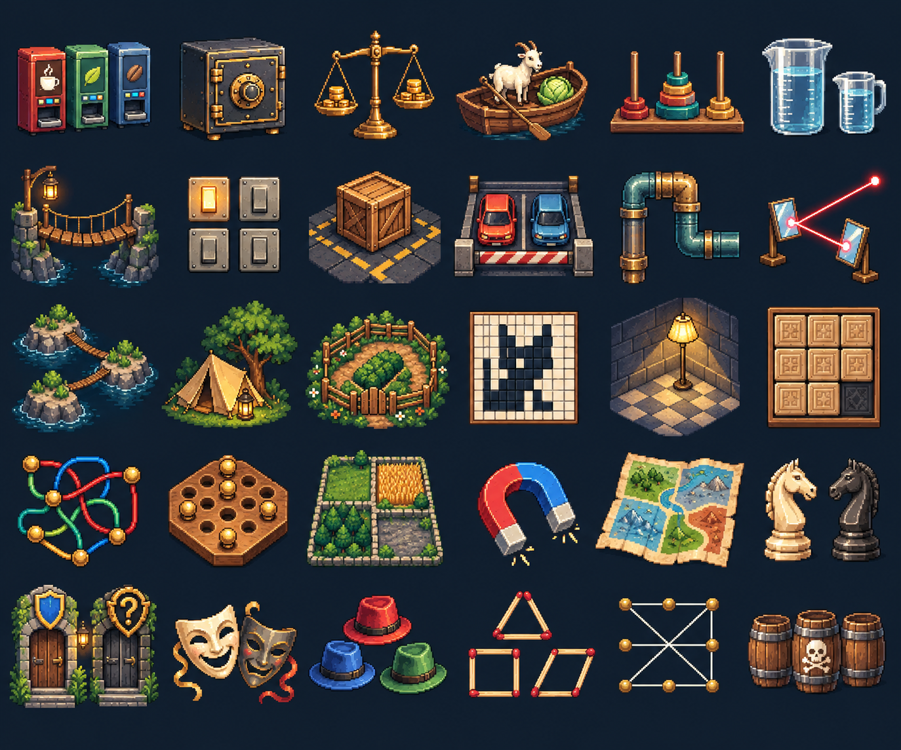

# Оглавление головоломок

30 задач в шести разделах: 9 реализованы, 21 предложены. У предложенных задач правила и уровни — проектный замысел, не обещание готовой игры.

[Иллюстрированное оглавление](../catalog.html) · [Открыть игру](../index.html)

## Разделы

- [Найти скрытое](#deduction) — 7 задач.
- [Спланировать ходы](#planning) — 8 задач.
- [Построить связи](#connections) — 5 задач.
- [Заполнить по условиям](#constraints) — 6 задач.
- [Изменить систему](#systems) — 2 задач.
- [Посмотреть иначе](#perspective) — 2 задач.

## Первая очередь развития

Склад уже реализован. Ближайшие кандидаты — лазерная мастерская, острова и мастерская мозаики: направление луча, построение связей и заполнение рисунка.

## Найти скрытое

Собирать наблюдения и отличать доказанный вывод от догадки.

### Кафе · Неверные наклейки

**Уже в игре: 3 уровня.**

Определи содержимое трёх автоматов по наклейкам и купленным пробам.

**Цель:** Правильно подписать все автоматы так, чтобы наблюдения оставляли только одну расстановку.

**Правила:**

1. Один автомат выдаёт чай, один кофе, третий выбирает напиток случайно 50/50.
2. Условие о правильности наклеек зависит от уровня.
3. Одна проба стоит монету. Угадывание без достаточных оснований не засчитывается.

**Управление:** Нажми на автомат, выбери подписи А, Б и В справа и проверь вывод.

**Уровни:**

1. Все наклейки ложные; 3 монеты.
2. Ровно одна наклейка верна; 3 монеты.
3. Наклейкам нет гарантий; 6 монет.

**Что тренирует:** Выбор информативной проверки и исключение гипотез.

**Подсказка:** Сравнивает возможные расстановки по уже видимым наклейкам и пробам. При нехватке монет предлагает повтор.

Несколько одинаковых проб не исключают случайный автомат. На третьем уровне иногда необходим новый раунд.

### Сейф · Быки и коровы

**Уже в игре: 3 уровня.**

Подбери код по точным и неполным совпадениям.

**Цель:** Узнать секретный код до исчерпания попыток.

**Правила:**

1. Все цифры в коде различаются.
2. ● показывает число цифр на своих местах; ○ — число правильных цифр в других позициях.
3. Знаки не привязаны к конкретным позициям введённого кода.

**Управление:** Нажимай на цифры, чтобы изменить их, затем нажми «Открыть».

**Уровни:**

1. 2 цифры 0–3, 6 попыток.
2. 3 цифры 0–5, 8 попыток.
3. 4 цифры 0–5, 10 попыток.

**Что тренирует:** Последовательная проверка гипотез и совместное использование нескольких ограничений.

**Подсказка:** Предлагает код, совместимый с историей ответов. Секретное значение не читает.

### Весы · Фальшивая монета

**Уже в игре: 3 уровня.**

Найди отличающуюся монету ограниченным числом сравнений.

**Цель:** Назвать одну фальшивую монету.

**Правила:**

1. На чашах должны лежать равные по числу непустые группы монет.
2. В первых двух уровнях фальшивая монета тяжелее; в третьем может быть легче или тяжелее.
3. Взвешивания ограничены, окончательный ответ один.

**Управление:** Выбери чашу, нажми на монеты, взвесь. Для ответа нажми «Назвать монету» и выбери её.

**Уровни:**

1. 3 монеты, 1 взвешивание, одна тяжелее.
2. 9 монет, 2 взвешивания, одна тяжелее.
3. 9 монет, 3 взвешивания, вес отличается в неизвестную сторону.

**Что тренирует:** Планирование эксперимента и разделение вариантов по исходам.

**Подсказка:** Фильтрует гипотезы по протоколу взвешиваний и предлагает различающее их сравнение.

### Две двери · Два стража

**Предложено: ещё не реализовано.**

Выбери вопрос, который поможет найти безопасную дверь.

**Цель:** Использовать разрешённое число вопросов и выбрать правильную дверь.

**Правила:**

1. Один страж всегда говорит правду, другой всегда лжёт.
2. Оба знают, где безопасный выход.
3. Число вопросов и допустимые формулировки объявляются до начала.

**Управление:** Предлагается выбор адресата и вопроса из коротких вариантов, затем выбор двери.

**Предлагаемые уровни:**

1. Один известный правдивый страж: освоить вопросы.
2. Один неизвестный страж с заданным типом ответа.
3. Классические два стража и один вопрос.

**Что тренирует:** Вложенные высказывания и устойчивость вопроса к лжи.

**Подсказка:** Предлагается показать, как один вопрос работает при обоих распределениях ролей.

Формулировки и варианты ответов нужно зафиксировать до реализации, чтобы у сцены не было неоднозначных трактовок.

### Рыцари и лжецы · Логические высказывания

**Предложено: ещё не реализовано.**

Восстанови роли персонажей по их утверждениям.

**Цель:** Назначить каждому персонажу роль, согласующуюся со всеми репликами.

**Правила:**

1. Рыцарь всегда говорит правду, лжец всегда лжёт.
2. Утверждения оцениваются относительно назначенных ролей.
3. Для задачи на однозначный вывод должен существовать ровно один ответ.

**Управление:** Нажимай на портреты, меняя предполагаемую роль, и проверяй всю расстановку.

**Предлагаемые уровни:**

1. Два персонажа и одно простое утверждение.
2. Три персонажа со ссылками друг на друга.
3. Утверждения с «и», «или» и отрицанием.

**Что тренирует:** Согласованность логических моделей.

**Подсказка:** Предлагается показать первое утверждение, нарушенное текущим назначением ролей.

### Шляпы мудрецов · Знание о знании

**Предложено: ещё не реализовано.**

Пойми, что персонаж может узнать, видя только чужие шляпы.

**Цель:** Выбрать вывод, который следует из наблюдений и публичных ответов персонажей.

**Правила:**

1. Каждому персонажу видна только явно обозначенная часть сцены.
2. Количество и допустимые цвета шляп объявляются заранее.
3. Реплика «я не знаю» тоже ограничивает возможные ситуации.

**Управление:** Переключай точку зрения персонажей и выбирай обоснованный ответ.

**Предлагаемые уровни:**

1. Один вывод из видимых шляп.
2. Вывод после ответа другого персонажа.
3. Цепочка публичных ответов.

**Что тренирует:** Различение собственной информации и знаний другого.

**Подсказка:** Предлагается показать две ситуации, которые персонаж пока не может различить.

Нужны авторские сценарии с точным порядком реплик; абстрактного названия недостаточно для готового уровня.

### Подозрительная бочка · Кодирование проверок

**Предложено: ещё не реализовано.**

Спланируй проверки, чтобы найти одну отличающуюся ёмкость.

**Цель:** По результатам ограниченного набора тестов определить одну бочку.

**Правила:**

1. Ровно одна бочка даёт положительный сигнал теста.
2. В один тест можно включить несколько образцов.
3. Время получения результата и число доступных раундов объявлены заранее.

**Управление:** Выбирай бочки для каждого условного тестера и запускай раунд проверок.

**Предлагаемые уровни:**

1. Две ёмкости и один бинарный тест.
2. Несколько ёмкостей и независимые тесты.
3. Один одновременный раунд, где комбинации результатов кодируют ответ.

**Что тренирует:** Двоичное кодирование информации и дизайн эксперимента.

**Подсказка:** Предлагается показать, какие бочки всё ещё имеют одинаковые коды результатов.

Для игры лучше использовать безопасный вымышленный индикатор, а не реалистичные действия с ядом.

## Спланировать ходы

Предвидеть последствия, тупики и цену обратного пути.

### Переправа · Волк, коза и капуста

**Уже в игре: 3 уровня.**

Перевези пассажиров, сохраняя безопасность обоих берегов.

**Цель:** Доставить фермера и всех пассажиров на другой берег.

**Правила:**

1. Лодка вмещает фермера и одного пассажира.
2. Без фермера коза съест капусту, а волк — козу.
3. Можно переплывать одному и возвращать пассажира назад.

**Управление:** Выбери пассажира на своём берегу и нажми на лодку. Повторный выбор высаживает пассажира.

**Уровни:**

1. Коза и капуста: освоить посадку и возврат.
2. Добавляется волк; лимита рейсов нет.
3. Все трое; уложиться в 7 рейсов.

**Что тренирует:** Планирование последовательности и проверка допустимых состояний.

**Подсказка:** Ищет короткий безопасный маршрут из текущего положения.

### Башня · Ханойская башня

**Уже в игре: 3 уровня.**

Перенеси стопку дисков на правую стойку.

**Цель:** Собрать все диски на правой стойке в правильном порядке.

**Правила:**

1. Переносится только один верхний диск.
2. Больший диск нельзя класть на меньший.
3. Промежуточную стойку можно использовать сколько угодно.

**Управление:** Нажми стойку-источник и стойку назначения. Повторный выбор отменяет перенос.

**Уровни:**

1. 2 диска; оптимум 3 хода.
2. 3 диска; оптимум 7 ходов.
3. 4 диска; оптимум 15 ходов.

**Что тренирует:** Рекурсия, разбиение задачи на подзадачи и роль промежуточного положения.

**Подсказка:** Находит короткий путь по допустимым перемещениям. Лимита ходов в игре нет.

### Мост и фонарь · Переход с разными скоростями

**Уже в игре: 3 уровня.**

Переведи всех через мост и верни фонарь нужным людям.

**Цель:** Доставить путешественников на другой берег до истечения общего времени.

**Правила:**

1. Одновременно идут один или два человека и обязательно несут фонарь.
2. Переход занимает время самого медленного выбранного человека.
3. Обратные переходы тоже расходуют время.

**Управление:** Выбери путешественников на берегу с фонарём и нажми «Идти».

**Уровни:**

1. Скорости 1 и 2 мин; лимит 2 мин.
2. 1, 2 и 5 мин; лимит 8 мин.
3. 1, 2, 5 и 10 мин; лимит 17 мин.

**Что тренирует:** Оптимизация стоимости маршрута и возвратов.

**Подсказка:** Ищет маршрут с минимальным оставшимся временем и проверяет, помещается ли он в лимит.

### Склад · Сокобан

**Уже в игре: 3 уровня.**

Толкай ящики к меткам, не загоняя их в тупики.

**Цель:** Поставить все ящики на золотые метки, сохранив возможность подойти к ним с нужной стороны.

**Правила:**

1. Игрок ходит по свободным клеткам и может толкнуть один ящик.
2. Тянуть ящик или толкать два сразу нельзя.
3. Ящик у стены или в углу может перекрыть решение.

**Управление:** Нажми свободную клетку, чтобы подойти. Нажми соседний ящик, чтобы толкнуть. Кнопка ↶ возвращает последнее действие.

**Уровни:**

1. Один ящик и прямая дорога к цели.
2. Два ящика: сначала освободить проход.
3. Три ящика: сначала заполнить дальнюю цель.

**Что тренирует:** Предвидение необратимых ходов и тупиков.

**Подсказка:** Ищет путь по допустимым толчкам и подходам к ящикам. При тупике предлагает отмену, а не недопустимый ход.

### Гараж · Заблокированный выезд

**Предложено: ещё не реализовано.**

Освободи выезд, передвигая мешающие машины.

**Цель:** Вывести отмеченную машину через край площадки.

**Правила:**

1. Каждая машина движется вдоль своей ориентации.
2. Машины не могут пересекаться или перепрыгивать друг через друга.
3. Иногда нужно временно занять освобождённый проезд.

**Управление:** Предлагается перетаскивание машины вдоль её полосы либо выбор и клик в доступную позицию.

**Предлагаемые уровни:**

1. Одна помеха у выезда.
2. Для освобождения одной машины нужно сдвинуть другую.
3. Цепочка взаимных блокировок.

**Что тренирует:** Планирование пространства и зависимостей.

**Подсказка:** Предлагается поиск по положениям машин; отмена хода сохраняет возможность экспериментировать.

### Площадь · Пятнашки

**Предложено: ещё не реализовано.**

Верни плитки на места, используя одну пустую клетку.

**Цель:** Собрать заданный порядок плиток.

**Правила:**

1. Передвигается только плитка рядом с пустой клеткой.
2. За ход плитка занимает пустое место.
3. Стартовые позиции должны генерироваться допустимыми ходами от цели.

**Управление:** Нажимай на соседнюю с пустотой плитку.

**Предлагаемые уровни:**

1. Поле 2×3 и короткая перестановка.
2. Поле 3×3.
3. Поле 4×4 с более глубокой перестановкой.

**Что тренирует:** Планирование циклов перестановок.

**Подсказка:** Предлагается поиск короткого улучшения; для старшего поля нужно ограничить стоимость поиска.

### Одинокий колышек · Peg solitaire

**Предложено: ещё не реализовано.**

Убирай фишки прыжками, оставляя одну.

**Цель:** Оставить на доске ровно одну фишку; при необходимости — в отмеченной клетке.

**Правила:**

1. Фишка прыгает через соседнюю в пустое место за ней.
2. Перепрыгнутая фишка убирается.
3. Доступные направления объявляются на поле; для первой версии — горизонталь и вертикаль.

**Управление:** Выбери фишку и допустимую клетку приземления. Нужна отмена хода.

**Предлагаемые уровни:**

1. Короткая цепочка прыжков.
2. Небольшой крест.
3. Поле, где последний колышек должен оказаться в цели.

**Что тренирует:** Планирование удаления и контроль конечной позиции.

**Подсказка:** Предлагается поиск последовательности прыжков на небольших авторских полях.

### Шахматный двор · Обмен коней

**Предложено: ещё не реализовано.**

Поменяй местами две группы коней на маленькой доске.

**Цель:** Поставить каждого коня на цель его цвета.

**Правила:**

1. Конь ходит буквой Г.
2. Занятую клетку использовать нельзя; взятий нет.
3. Перемещения могут временно уводить фигуры от конечной цели.

**Управление:** Выбери коня, затем одну из подсвеченных допустимых клеток.

**Предлагаемые уровни:**

1. Один конь и несколько целей маршрута.
2. Две фигуры должны разойтись.
3. Две группы меняются местами.

**Что тренирует:** Поиск маршрута на графе ходов и координация фигур.

**Подсказка:** Предлагается поиск следующего допустимого хода; стартовые расстановки нужно отдельно доказать решаемыми.

## Построить связи

Соединять, направлять и распутывать, сохраняя общие условия.

### Водопровод · Соединение сети

**Предложено: ещё не реализовано.**

Поворачивай трубы, соединяя их с источником.

**Цель:** Собрать сеть, в которой все нужные участки связаны с источником и нет открытых концов.

**Правила:**

1. Клетка вращается, но не меняет форму трубы.
2. Соседние концы должны совпадать.
3. В обучении правила о циклах и границах объявляются явно.

**Управление:** Нажатие поворачивает трубу на четверть оборота.

**Предлагаемые уровни:**

1. Короткий путь из угловых труб.
2. Добавляются развилки.
3. Нужно проверить связность всей сети.

**Что тренирует:** Сочетание локальных стыковок и общего условия связности.

**Подсказка:** Предлагается выделять соединение, которое следует из границ и уже определённых соседей.

### Лазерная мастерская · Луч и зеркала

**Предложено: ещё не реализовано.**

Направь луч к приёмникам, поворачивая зеркала.

**Цель:** Активировать все отмеченные приёмники.

**Правила:**

1. Зеркало отражает луч под прямым углом.
2. Стены останавливают луч.
3. Разветвители и несколько источников вводятся только на последующих уровнях.

**Управление:** Нажимай на зеркало, чтобы менять его ориентацию; результат виден сразу.

**Предлагаемые уровни:**

1. Один источник, одно зеркало, один приёмник.
2. Несколько последовательных отражений.
3. Несколько приёмников и развилка луча.

**Что тренирует:** Пространственное предвидение и причинные цепочки.

**Подсказка:** Предлагается показать первое отражение, которое мешает достижению цели; набор элементов ещё нужно зафиксировать.

### Острова · Хаси / Hashiwokakero

**Предложено: ещё не реализовано.**

Соедини острова мостиками по числовым подсказкам.

**Цель:** Получить одну связную сеть с правильным числом мостов у каждого острова.

**Правила:**

1. Мосты идут по горизонтали или вертикали между ближайшими видимыми островами.
2. Между двумя островами допустимы один или два моста.
3. Мосты не пересекаются; число на острове — количество его мостов.

**Управление:** Выбери два острова; повторное действие меняет число мостов или снимает их.

**Предлагаемые уровни:**

1. Цепочка островов с очевидными связями.
2. Двойные мосты и несколько направлений.
3. Локально верные связи не должны разделить сеть.

**Что тренирует:** Учёт ограничений и связности.

**Подсказка:** Предлагаются логические выводы по оставшимся степеням и возможным связям островов.

### Сад с оградой · Slitherlink

**Предложено: ещё не реализовано.**

Построй один замкнутый забор по подсказкам в клетках.

**Цель:** Провести одну петлю без разрывов и ответвлений.

**Правила:**

1. Число в клетке задаёт количество занятых сторон вокруг неё.
2. В каждой занятой вершине сходятся две линии.
3. Несколько отдельных петель не являются решением.

**Управление:** Нажимай на рёбра сетки, чтобы ставить линию или отметку запрета.

**Предлагаемые уровни:**

1. Маленькая петля с нулями и тройками.
2. Совместные ограничения соседних клеток.
3. Не допустить преждевременного замыкания отдельной петли.

**Что тренирует:** Локальные следствия и глобальная топология.

**Подсказка:** Предлагается указывать ребро, которое определяется числом клетки или продолжением линии.

### Клубок проводов · Untangle

**Предложено: ещё не реализовано.**

Перемести узлы так, чтобы провода перестали пересекаться.

**Цель:** Разложить сеть на плоскости без пересечений её рёбер.

**Правила:**

1. Узлы можно передвигать, связи между ними сохраняются.
2. Общая вершина не считается пересечением.
3. Задаются только сети, у которых существует плоская укладка.

**Управление:** Перетаскивай узлы; пересекающиеся участки подсвечиваются.

**Предлагаемые уровни:**

1. Один очевидный крест.
2. Несколько связанных пересечений.
3. Группа узлов с внутренней и внешней частями.

**Что тренирует:** Геометрическая организация и изменение точки зрения.

**Подсказка:** Предлагается выбрать узел и область, куда его полезно переместить; жест не должен требовать пиксельной точности.

## Заполнить по условиям

Совмещать локальные подсказки и получать единую картину.

### Палаточный лагерь · Tents

**Предложено: ещё не реализовано.**

Размести палатки возле деревьев с учётом чисел по краям.

**Цель:** Сопоставить каждому дереву палатку и соблюсти все ограничения.

**Правила:**

1. Палатка находится по горизонтали или вертикали от связанного с ней дерева.
2. Палатки не касаются, в том числе по диагонали.
3. Числа задают количество палаток в строках и столбцах.

**Управление:** Нажатие ставит палатку; второе действие отмечает пустую клетку.

**Предлагаемые уровни:**

1. Небольшая поляна с одиночными деревьями.
2. Несколько деревьев претендуют на соседние клетки.
3. Ответ определяется пересечением ограничений строк и столбцов.

**Что тренирует:** Согласование нескольких условий и исключение соседних клеток.

**Подсказка:** Предлагается показывать одно дерево или строку, где следующий вывод однозначен.

### Мастерская мозаики · Нонограммы

**Предложено: ещё не реализовано.**

Прояви рисунок по длинам закрашенных групп.

**Цель:** Заполнить поле в соответствии со всеми подсказками строк и столбцов.

**Правила:**

1. Числа описывают группы закрашенных клеток по порядку.
2. Между группами остаётся хотя бы одна пустая клетка.
3. Ответ должен удовлетворять строкам и столбцам одновременно.

**Управление:** Нажатие закрашивает клетку, альтернативное действие отмечает пустоту.

**Предлагаемые уровни:**

1. Поле 5×5 с очевидными полными линиями.
2. Нужно находить пересечения возможных размещений групп.
3. Более плотная картинка с чередованием выводов по строкам и столбцам.

**Что тренирует:** Работа с диапазонами и пересечением ограничений.

**Подсказка:** Предлагается выделять клетку, одинаковую во всех допустимых заполнениях выбранной линии.

### Фонарщики · Akari / Light Up

**Предложено: ещё не реализовано.**

Освети все проходы, не направляя лампы друг на друга.

**Цель:** Осветить каждую свободную клетку и выполнить числовые ограничения стен.

**Правила:**

1. Лампа освещает строку и столбец до стены.
2. Две лампы не должны видеть друг друга.
3. Число на стене задаёт количество ламп по её четырём сторонам.

**Управление:** Нажимай свободную клетку для лампы или отметки запрета.

**Предлагаемые уровни:**

1. Одна комната и простые тени.
2. Пронумерованные стены.
3. Несколько комнат с общими линиями освещения.

**Что тренирует:** Видимость и сочетание геометрических ограничений.

**Подсказка:** Предлагается показать неосвещённую клетку с единственным возможным источником света.

### Землемер · Shikaku

**Предложено: ещё не реализовано.**

Раздели землю на прямоугольные участки заданной площади.

**Цель:** Покрыть всё поле непересекающимися прямоугольниками.

**Правила:**

1. Каждый прямоугольник содержит ровно одно число.
2. Площадь прямоугольника равна этому числу.
3. Ни одна клетка не должна остаться за пределами участков.

**Управление:** Выделяй прямоугольник от одного угла к другому.

**Предлагаемые уровни:**

1. Очевидные вытянутые участки.
2. У одного числа несколько вариантов формы.
3. Формы определяются соседними участками.

**Что тренирует:** Разложение площади и покрытие пространства.

**Подсказка:** Предлагается показывать участок с единственным допустимым прямоугольником.

### Магнитная лаборатория · Magnets

**Предложено: ещё не реализовано.**

Размести полюса магнитов с учётом чисел и соседства.

**Цель:** Заполнить разрешённые пары клеток магнитами и соблюсти все ограничения.

**Правила:**

1. Магнит занимает пару клеток с противоположными полюсами.
2. Одноимённые полюса не соприкасаются по сторонам.
3. Числа задают количество плюсов и минусов в строках и столбцах; часть пар может оставаться пустой.

**Управление:** Нажатие циклически меняет ориентацию магнита или оставляет пару пустой.

**Предлагаемые уровни:**

1. Несколько фиксированных пар.
2. Ограничения полюсов по строкам.
3. Объединение требований строк, столбцов и соседства.

**Что тренирует:** Сочетание парных состояний и ограничений количества.

**Подсказка:** Предлагается исключать ориентации, которые нарушают соседство или уже заполненную норму строки.

### Малярная артель · Раскраска карты

**Предложено: ещё не реализовано.**

Раскрась соседние области разными цветами.

**Цель:** Заполнить все области, не нарушив ограничения соседства и заданных цветов.

**Правила:**

1. Области с общей границей должны отличаться.
2. Касание только в точке не считается соседством.
3. Часть цветов уже задана; набор доступных цветов объявлен.

**Управление:** Выбери цвет и нажимай на области.

**Предлагаемые уровни:**

1. Небольшая карта с очевидными соседями.
2. Цепочка вынужденных цветов.
3. Более связная карта с несколькими ограничениями на область.

**Что тренирует:** Графовые ограничения и последовательное исключение.

**Подсказка:** Предлагается показывать область с минимальным числом оставшихся цветов.

## Изменить систему

Понимать, как одно действие меняет несколько связанных объектов.

### Кувшины · Отмеривание воды

**Уже в игре: 3 уровня.**

Получи точный объём с помощью двух сосудов без делений.

**Цель:** Оставить в одном кувшине ровно нужное число литров.

**Правила:**

1. Разрешены заполнение до края, полное опустошение и переливание.
2. При переливании вода течёт до опустошения источника или заполнения другого сосуда.
3. Промежуточные деления отсутствуют.

**Управление:** Выбери кувшин и действие «Наполнить», «Вылить» или «Перелить».

**Уровни:**

1. Кувшины 2 и 3 л; получить 1 л.
2. 3 и 5 л; получить 4 л.
3. 4 и 7 л; получить 5 л.

**Что тренирует:** Поиск пути между состояниями и использование остатков.

**Подсказка:** Находит короткую последовательность допустимых операций из текущих объёмов.

### Свет погас · Lights Out

**Уже в игре: 3 уровня.**

Погаси поле ламп, связанных перекрёстными переключениями.

**Цель:** Выключить все лампы одновременно.

**Правила:**

1. Нажатие переключает лампу и её ортогональных соседей.
2. Диагональные соседи не изменяются.
3. Повторное нажатие отменяет эффект того же переключения.

**Управление:** Нажимай на лампы поля.

**Уровни:**

1. Поле 2×2.
2. Поле 3×3.
3. Поле 4×4.

**Что тренирует:** Чётность и взаимозависимые изменения системы.

**Подсказка:** Вычисляет допустимый набор переключений с помощью системы над GF(2). Все стартовые позиции решаемы.

## Посмотреть иначе

Проверять собственные предположения о допустимых действиях.

### Спичечная мастерская · Перестановки спичек

**Предложено: ещё не реализовано.**

Исправь равенство или фигуру несколькими перемещениями палочек.

**Цель:** Получить допустимый результат за указанное число перестановок.

**Правила:**

1. Можно перемещать только заданное число спичек.
2. Правила цифр, знаков и допустимых фигур объявляются явно.
3. Добавлять или ломать спички нельзя, если это не оговорено отдельно.

**Управление:** Выбери спичку, затем разрешённое новое положение.

**Предлагаемые уровни:**

1. Исправить равенство одной перестановкой.
2. Исправить равенство двумя перестановками.
3. Получить заданное число квадратов или треугольников.

**Что тренирует:** Проверка привычной интерпретации и пространственные преобразования.

**Подсказка:** Предлагается указать палочку, которую стоит рассмотреть, до раскрытия её конечного места.

### Девять точек · Непрерывная ломаная

**Предложено: ещё не реализовано.**

Соедини все точки ограниченным числом прямых отрезков.

**Цель:** Провести непрерывную ломаную через все точки, соблюдая лимит отрезков.

**Правила:**

1. Каждый участок между поворотами должен быть прямым.
2. Линию нельзя прерывать.
3. Разрешены выходы за границу рисунка; это правило не скрывается от игрока.

**Управление:** Щёлкай по вершинам ломаной; предпросмотр показывает, какие точки она проходит.

**Предлагаемые уровни:**

1. Освоить непрерывную ломаную на простом узоре.
2. Девять точек 3×3 и четыре отрезка.
3. Другой авторский узор с явно заданным лимитом.

**Что тренирует:** Отделение реальных ограничений от самостоятельно придуманных.

**Подсказка:** Предлагается подсветить допустимое продолжение за пределами крайней точки.

## Основания и графика

Классические механики сверялись с [коллекцией Саймона Тэтэма](https://www.chiark.greenend.org.uk/~sgtatham/puzzles/), [правилами Sokoban](https://www.sokoban.jp/rule.html) и [правилами Slitherlink от Nikoli](https://www.nikoli.co.jp/en/puzzles/slitherlink/). Названия локаций, наборы уровней для предложенных задач и их оформление — проектные предложения.

Иконки созданы встроенным ImageGen как один атлас 6×5. Исходный набор и полный промпт сохранены в `assets/catalog/`. В интерфейсе используется CSS-позиционирование исходного атласа, отдельные изображения не вырезались.
